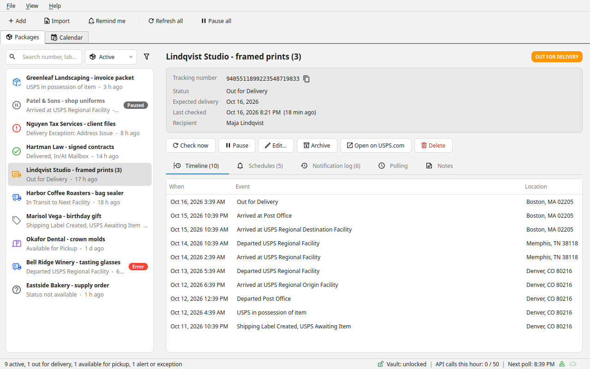
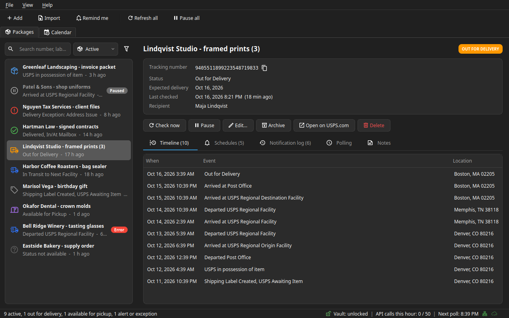
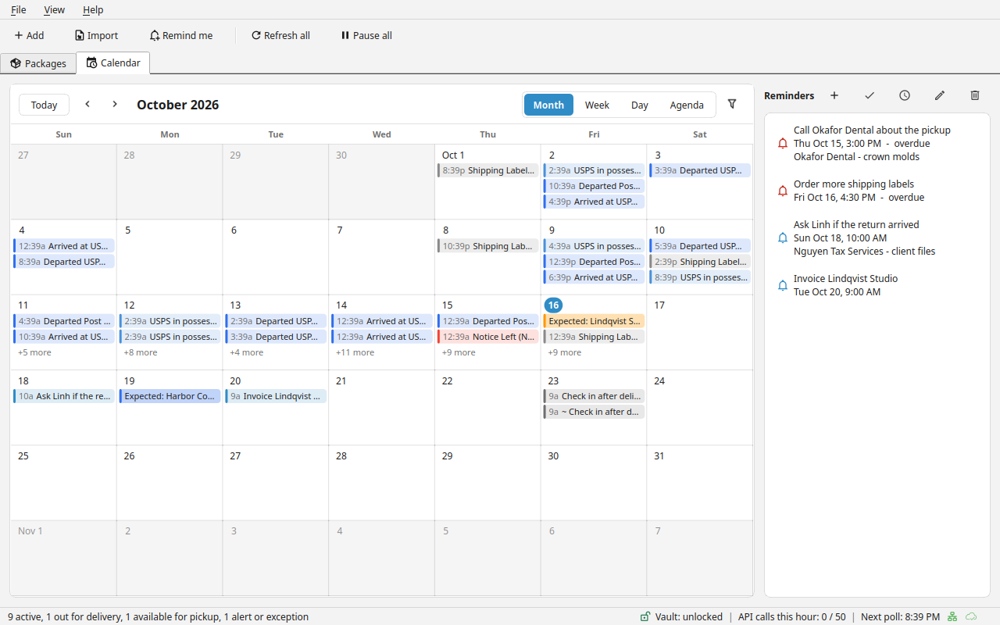
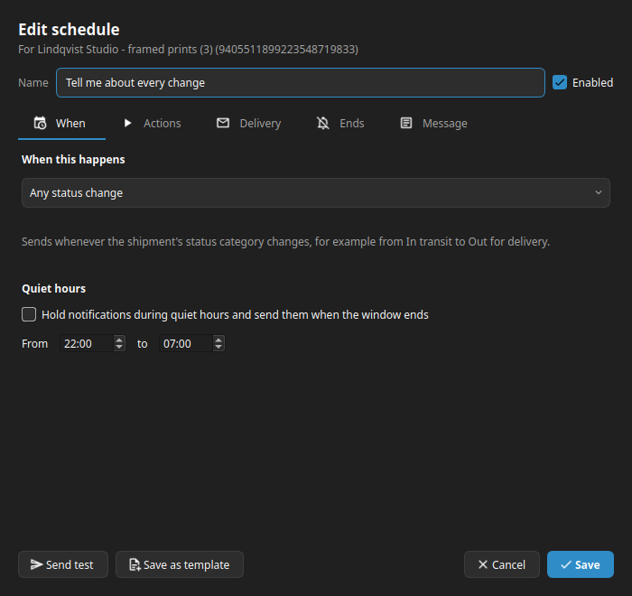

<div align="center">


# QPackageTracker

Follow your packages from label to doorstep, from USPS, UPS, FedEx, DHL and more, and get told when something changes.

[](https://github.com/Quynn-Software-Solutions/USPSTracker-releases/releases/latest)
[](https://github.com/Quynn-Software-Solutions/USPSTracker-releases/releases)




[Download](#download) | [Screenshots](#screenshots) | [Free and Business](#free-and-business) | [Verify a download](#verify-a-download) | [Support](#support)

</div>

QPackageTracker is a desktop app for Windows and Linux that keeps an eye on your tracking numbers: USPS for everyone, and UPS, FedEx, DHL and more with Business. Add a number, or paste or import a whole list. The app checks the carrier's official API on a schedule you control, keeps each package's full event history, and notifies you with the schedules you set up: a desktop notification when a package is out for delivery, an email to a customer when it arrives, a reminder if it hasn't moved in three days.

It runs quietly in the system tray, works offline between checks, and keeps everything on your computer.

This repository holds the **release downloads only**. The source code is private.

## Download

Get the latest version from the **[Releases page](https://github.com/Quynn-Software-Solutions/USPSTracker-releases/releases/latest)**. Each release has:

| File | Use it when |
|---|---|
| `QPackageTracker-<version>-windows-installer.exe` | **Windows (recommended).** Installs for your Windows account only, so no administrator rights are needed. Updates install from inside the app. |
| `QPackageTracker-<version>-windows-portable.zip` | You want to run it from a folder or a USB drive without installing. It tells you about updates but doesn't install them. |
| `QPackageTracker_<version>_amd64.deb` | **Linux, Ubuntu 22.04 or newer, or Debian 12 or newer.** Installs to `/opt/QPackageTracker`, with a `qpackagetracker` command and a menu entry. Updates install from inside the app. |
| `QPackageTracker-<version>-x86_64.AppImage` | **Linux, any distribution that runs AppImages.** A single file: mark it executable and run it. Updates install from inside the app. |
| `QPackageTracker-<version>-x86_64.flatpak` | Flatpak, sandboxed, any distribution with Flatpak; install with the commands below. The app tells you about updates. |
| `QPackageTracker_<version>_amd64.snap` | Snap, sandboxed; install with the commands below. The app tells you about updates. |
| `SHA256SUMS.txt` and `*.sig` | To check a download is genuine (see [Verify a download](#verify-a-download)). |

On Windows, pick the installer. On Linux, pick the `.deb` on Ubuntu or Debian, the AppImage on any other distribution that runs AppImages, or the Flatpak or Snap if you prefer a sandboxed install (sandboxed installs tell you about updates but don't install them; install the newer file to update).

**Installing on Linux**

```
# .deb (Ubuntu, Debian)
sudo apt install ./QPackageTracker_<version>_amd64.deb
# Flatpak
flatpak remote-add --user --if-not-exists flathub https://dl.flathub.org/repo/flathub.flatpakrepo
flatpak install --user ./QPackageTracker-<version>-x86_64.flatpak
# Snap
sudo snap install --dangerous ./QPackageTracker_<version>_amd64.snap
# AppImage
chmod +x QPackageTracker-<version>-x86_64.AppImage && ./QPackageTracker-<version>-x86_64.AppImage
```

All Linux builds are 64-bit (x86_64).

**Requirements**

- Windows 10 or 11, 64-bit, or a 64-bit Linux desktop: Ubuntu 22.04 or newer, Debian 12 or newer, or any distribution that runs AppImages (X11 or Wayland).
- A system tray for the tray features. On some Linux desktops a tray extension must be enabled.
- Tracking data from one of:
  - **USPS API:** free credentials from a USPS Business Account. The first-run setup walks you through getting them, with screenshots.
  - **[Trace API](https://traceapi.dev/):** its free plan covers 1,000 lookups a month.
  - **Business only:** your own UPS, FedEx, DHL or Ship24 developer keys.
- **Optional:** classic Outlook for Windows (for the Outlook email channel), or any SMTP mail server.

**First run.** The setup wizard asks for your tracking credentials and how often to check packages. It then asks how you'd like to be notified, and for a vault password. Credentials are stored encrypted (AES-256-GCM). On Windows they unlock with your Windows sign-in by default. On Linux the vault asks for its password.

Want to look around first? **Help > Try Demo Mode** opens the app with sample packages and sends nothing.

## Screenshots

<table>
  <tr>
    <td align="center"><br>Packages and timeline</td>
    <td align="center"><br>Calendar and reminders</td>
    <td align="center"><br>Notification schedule</td>
  </tr>
</table>

More in the **[screenshot gallery](GALLERY.md)**: every dialog in the light and dark themes.

## Features

- **Add, paste or import.** Paste a list or import a CSV or Excel file. The preview flags duplicates and numbers that don't look like USPS.
- **Polling you control.** Check intervals by status, working hours, per-package schedules, and an API budget that keeps you inside your USPS or Trace quota.
- **Notification schedules.** Trigger on any status change, a chosen status, a quiet period ("no update for 3 days"), daily times or a delay after delivery. Each schedule can notify, add a reminder, add a note, check now, pause or archive.
- **Channels.** Desktop notifications for everyone. With Business: classic Outlook (Windows), SMTP email, SMS (Twilio), Slack, Microsoft Teams, Discord and webhooks. All with quiet hours and automatic retries.
- **Calendar and reminders.** Every event, expected delivery and reminder on a month, week, day or agenda view.
- **Archive.** Delivered packages archive themselves and keep their full history.
- **Tray app.** Starts at login if you want, and keeps tracking with the window closed.

## Free and Business

QPackageTracker is free for personal use. A **Business** license is for tracking at volume, across carriers, and notifying other people. Every paid feature below is Business only; Free users see them in the app with a lock.

| Feature | Free | Business |
|---|---|---|
| **Included in both** | | |
| USPS and Trace API tracking, on every API plan | Yes | Yes |
| Desktop notifications (Windows, Linux) | Yes | Yes |
| Import, export, calendar, reminders, notification schedules, polling controls | Yes | Yes |
| Updates | Every update | Every update |
| **Business only** | | |
| Packages tracked at once (archived packages are unlimited) | 10 | Unlimited |
| Email: Outlook (classic) and SMTP | No | Yes |
| More notification channels: SMS (Twilio), Slack, Microsoft Teams, Discord and signed webhooks | No | Yes |
| More carriers: UPS, FedEx, DHL, and Ship24 for everything else | No | Yes |
| Order and customer fields (order number, customer, tags), in templates and imports | View only | Yes |
| Proof of delivery PDFs | No | Yes |
| Claims reminders for lost or damaged packages, with filing deadlines | No | Yes |
| Automatic intake: watched folder, email inbox, local API | No | Yes |
| Automatic backups with restore, plain or encrypted | No | Yes |

- **Entering a key:** enter it under **Help > License...**. One license covers one computer.
- **Moving a license:** reset it in the license portal, then activate it on the new PC.
- **Offline use:** a licensed install keeps working offline for 30 days, and warns you a week before that runs out.
- **If a license lapses:** nothing is deleted.
  - Notifications on Business channels (email, SMS, Slack and the others) are held, not lost, until a license is active again.
  - If more than 10 packages are being tracked, you choose which 10 keep updating. The others pause with their history intact.

## Updates

The app checks for updates once a day. You can also use **Help > Check for Updates...**.

- Updates install only when you click **Install**, unless you turn on **Settings > Updates > Install automatically when idle**. That installs during quiet hours, while the PC is idle.
- Every release is **signed**. The built-in updater verifies the signature and checksum before installing anything, and refuses a release that fails.
- **Beta channel:** opt in under **Settings > Updates** to get prerelease (`-dev`) builds early. They're signed the same way.
- Your packages, settings, vault and license are kept across updates.

## Verify a download

Each release publishes `SHA256SUMS.txt` and a detached GPG signature for it and for each file.

**Check the checksum (Windows, PowerShell):**

```powershell
Get-FileHash .\QPackageTracker-<version>-windows-installer.exe -Algorithm SHA256
```

Compare the result with the matching line in `SHA256SUMS.txt`.

**Check the checksum (Linux):**

```bash
sha256sum -c SHA256SUMS.txt --ignore-missing
```

**Check the signature (GnuPG):**

```bash
gpg --import release-key.asc
gpg --verify SHA256SUMS.txt.sig SHA256SUMS.txt
```

The release signing key's fingerprint is:

```
<RELEASE KEY FINGERPRINT, added with the first signed release>
```

The installer and the app are also code-signed (Authenticode) once the certificate is in place. Windows shows the publisher in the install prompt.

The app also checks its own files when it starts. If they've been modified or damaged it won't open, and it asks you to reinstall from this page. Your data is not affected.

## Privacy

- Your packages, history, settings and credentials stay on your computer.
- Tracking lookups go to the provider you choose (USPS, Trace, or with Business, UPS, FedEx, DHL or Ship24).
- Business users only: once a day the app checks the license with our server. It sends the license key, a hashed machine ID, the app version, and the network address the server sees. Nothing about your packages is sent.

## Support

- Email **support@quynnsoftware.com** with the version (Help > About) and, if something went wrong, the logs (Help > Logging > Collect Logs, on Windows and Linux alike).
- Report a problem with a release by opening an issue on this repository.

---

## Trademarks and affiliation

QPackageTracker is not affiliated with, endorsed by or sponsored by any of the services below. Each service's name, marks and logos belong to its owner and are used only to identify that service. Use of the USPS API is subject to the USPS terms and conditions. Terms and privacy links for each service are under Help > Vendor Documentation.

- USPS is a trademark of United States Postal Service. QPackageTracker is not affiliated with, endorsed by or sponsored by United States Postal Service.
- Trace is a trademark of Trace API (traceapi.dev). QPackageTracker is not affiliated with, endorsed by or sponsored by Trace API (traceapi.dev).
- UPS is a trademark of United Parcel Service of America, Inc. QPackageTracker is not affiliated with, endorsed by or sponsored by United Parcel Service of America, Inc.
- FedEx is a trademark of FedEx Corporation. QPackageTracker is not affiliated with, endorsed by or sponsored by FedEx Corporation.
- DHL is a trademark of Deutsche Post AG (DHL Group). QPackageTracker is not affiliated with, endorsed by or sponsored by Deutsche Post AG (DHL Group).
- Ship24 is a trademark of Ship24. QPackageTracker is not affiliated with, endorsed by or sponsored by Ship24.
- Outlook (classic) is a trademark of Microsoft Corporation. QPackageTracker is not affiliated with, endorsed by or sponsored by Microsoft Corporation.
- SMS (Twilio) is a trademark of Twilio Inc. QPackageTracker is not affiliated with, endorsed by or sponsored by Twilio Inc.
- Slack is a trademark of Slack Technologies, LLC. QPackageTracker is not affiliated with, endorsed by or sponsored by Slack Technologies, LLC.
- Discord is a trademark of Discord Inc. QPackageTracker is not affiliated with, endorsed by or sponsored by Discord Inc.
- Microsoft Teams is a trademark of Microsoft Corporation. QPackageTracker is not affiliated with, endorsed by or sponsored by Microsoft Corporation.

Carrier and service logos come from Simple Icons (CC0 1.0) and remain the trademarks of their owners.

© 2026 Quynn Software Solutions. Icons: Material Design Icons (Apache License 2.0).

App icon: `assets/images/icon.png` (PNG, 256 px) and `assets/images/icon.svg`.
